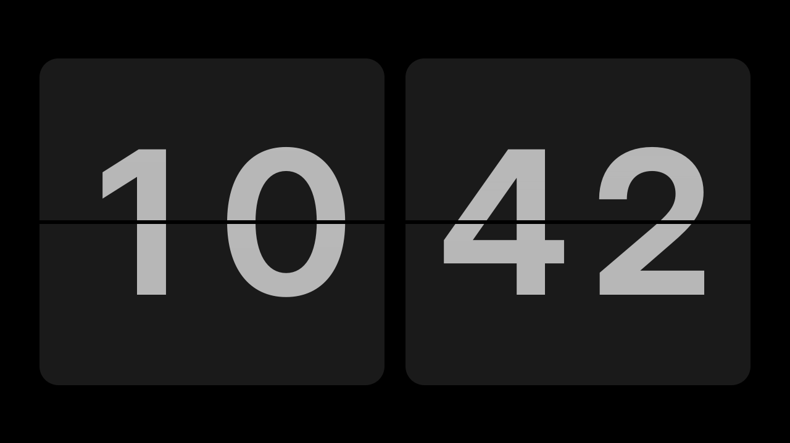

# openflip

A free, open-source flip clock for **macOS, Windows and Linux** — as a real
screensaver and as a standalone fullscreen/windowed app. Inspired by the
classic flip clock screensavers, built from scratch in Rust and released under
the MIT license.

> **Status:** early development. The clock runs as an app (no flip
> animation or screensaver integration yet) — see the [roadmap](docs/ROADMAP.md).



## Planned features (v0.1)

- Flip animation with a real 3D card fold, rendered on the GPU
- 12-hour or 24-hour time, optional seconds
- Optional weekday and date line
- Themes (background, card and digit colours), scaling, custom fonts
- All monitors or primary monitor only
- Settings as an in-app overlay, stored as TOML
- English and German user interface

## Platforms

| Platform | Screensaver | App |
|---|---|---|
| macOS | `.saver` bundle (Swift wrapper around the Rust core, unsigned for now) | fullscreen / windowed |
| Windows | `.scr` (`/s`, `/p`, `/c`) | fullscreen / windowed |
| Linux | XScreenSaver hack (X11) | fullscreen / windowed (X11 and Wayland, e.g. launched by an idle daemon) |

Platforms are implemented in this order: macOS, Windows, Linux. CI builds and
tests all three from day one.

## Building

Requires a recent stable Rust toolchain (see `rust-version` in `Cargo.toml`).

```sh
cargo build
cargo test
cargo run --release --bin openflip
```

On Linux the app needs the usual desktop libraries at runtime
(`libxkbcommon-x11` on X11, a Vulkan or OpenGL driver); every desktop
installation has them.

## Usage

```
openflip [--windowed] [--screenshot FILE [--size WxH]] [--time HH:MM[:SS]]
```

| Key | Action |
|---|---|
| `F` / `F11` | toggle fullscreen |
| `Esc` / `Q` | quit |

`--screenshot` renders a single frame to a PNG without opening a window;
`--time` freezes the clock at a given time, which is handy for screenshots.

## Configuration

Settings live in `config.toml` in your user config directory:

| OS | Path |
|---|---|
| macOS | `~/Library/Application Support/org.openflip.openflip/config.toml` |
| Windows | `%APPDATA%\openflip\openflip\config\config.toml` |
| Linux | `$XDG_CONFIG_HOME/openflip/config.toml` (usually `~/.config/openflip/`) |

```toml
time_format = "h24"   # or "h12"
show_seconds = false
show_date = true
theme = "classic"     # classic, light, amber or midnight
scale = 0.9           # share of the screen the clock may fill
# font = "/path/to/font.ttf"
monitors = "all"      # or "primary"
language = "german"   # or "english"; omit to follow the system
```

## Repository layout

```
crates/openflip-core   clock logic, configuration, translations (no OS/GPU code)
crates/openflip-render layout, themes and wgpu renderer (no windowing code)
crates/openflip-app    the openflip binary (winit window, CLI)
platform/macos         .saver bundle (Swift wrapper)          — planned
platform/windows       .scr packaging                          — planned
platform/linux         XScreenSaver integration                — planned
```

## Contributing

Contributions are welcome — please read [CONTRIBUTING.md](CONTRIBUTING.md) and
our [Code of Conduct](CODE_OF_CONDUCT.md).

## License

[MIT](LICENSE). The bundled font Inter Display is licensed under the
[SIL Open Font License 1.1](crates/openflip-render/assets/OFL.txt).
