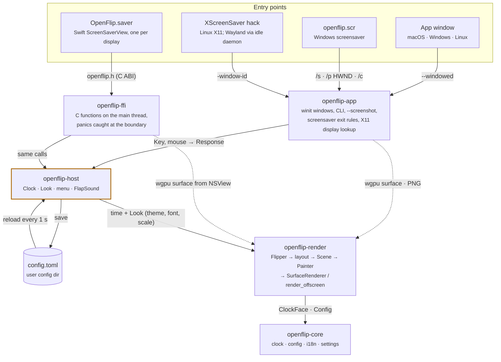
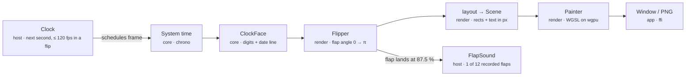

# Architecture

openflip ships as an app and as a screensaver on macOS, Windows and Linux.
Every one of those shells only supplies a drawing surface and input events.
What to show, when to draw and how to draw it lives in the shared crates.

## Crates and how they connect

Arrows point from caller to callee. Three of the four entry points are the
same `openflip` binary started with different arguments; the macOS
screensaver is Swift and reaches Rust through a C interface.

`openflip-host` is the seam: `openflip-app` and `openflip-ffi` both translate
platform events into the same `Clock` calls, so the app, the Windows and Linux
screensavers and the macOS saver behave identically. The dotted arrows are the
only part each host does on its own: handing the renderer a `wgpu` surface.
Every crate depends on `openflip-core`; only the edge from the renderer is
drawn.

## One frame, from time to pixels

The clock draws only when something changes. Between flips it sleeps until
just after the next second; during a flip (`FLIP_DURATION`, 0.6 s) it renders
at up to 120 fps.

Each stage is testable without the next: `Flipper` knows only timing,
`layout` produces a `Scene` without touching the GPU, and `render_offscreen`
turns a scene into an image, which is how `--screenshot` and the render tests
work.

## What each crate may not touch

| Crate | Boundary | Depends on |
|---|---|---|
| `openflip-core` | No windows, GPU or screensaver APIs. Pure data: time, config, translations. | chrono, serde, toml, directories |
| `openflip-render` | No windowing library. Draws into whatever `wgpu` texture or surface it is handed. | core, wgpu, skrifa, ab_glyph_rasterizer |
| `openflip-host` | Everything except the surface and raw input events. Hosts map their keys to `Key` and act on `Response`. | core, render, rodio, sys-locale |
| `openflip-ffi` | Main thread only. A panic returns "nothing happened" instead of taking the host process down. Header: `platform/macos/include/openflip.h`, kept in sync by hand. | core, host, render |
| `openflip-app` | Owns windows and the CLI. Picks app, screensaver, embedded preview or screenshot mode from the arguments. | core, render, host, winit, rfd, x11rb (Linux), windows-sys (Windows) |

When one of these boundaries or the flow above changes, update this page in
the same pull request.
